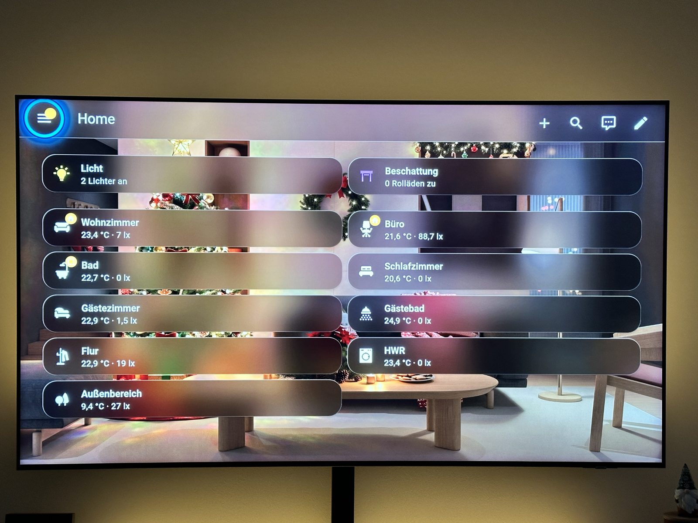
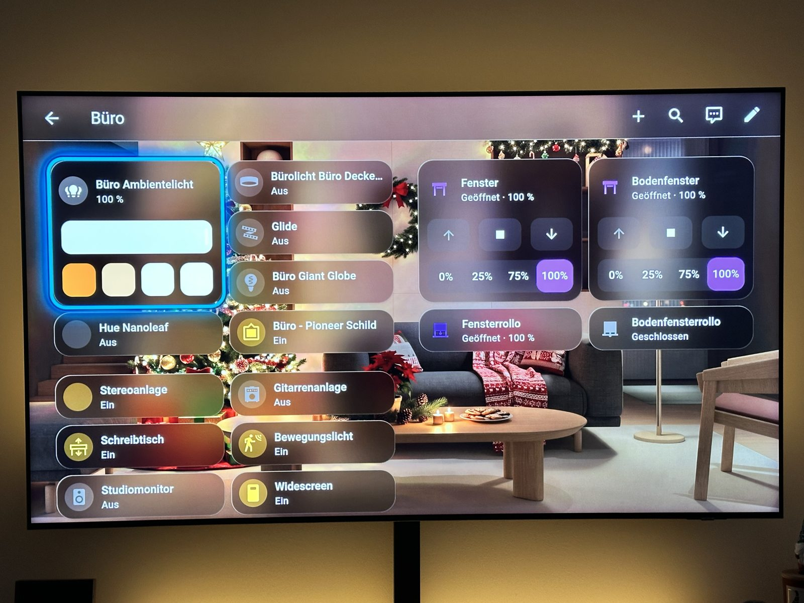
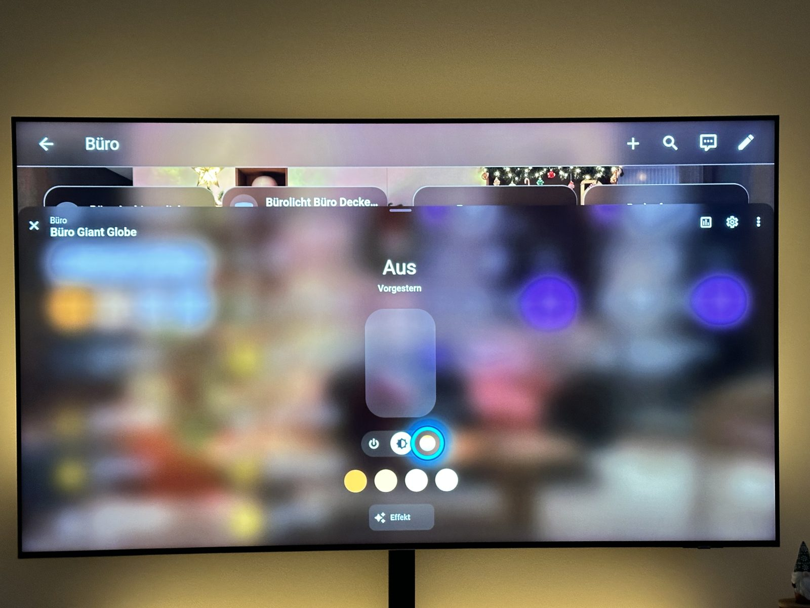
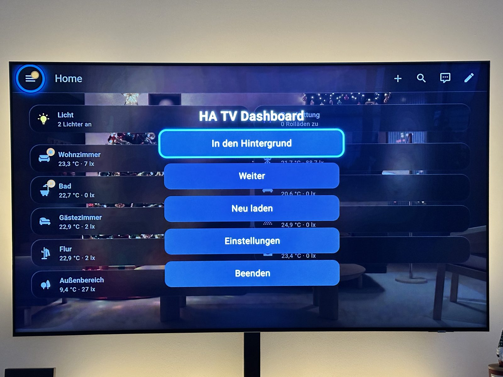
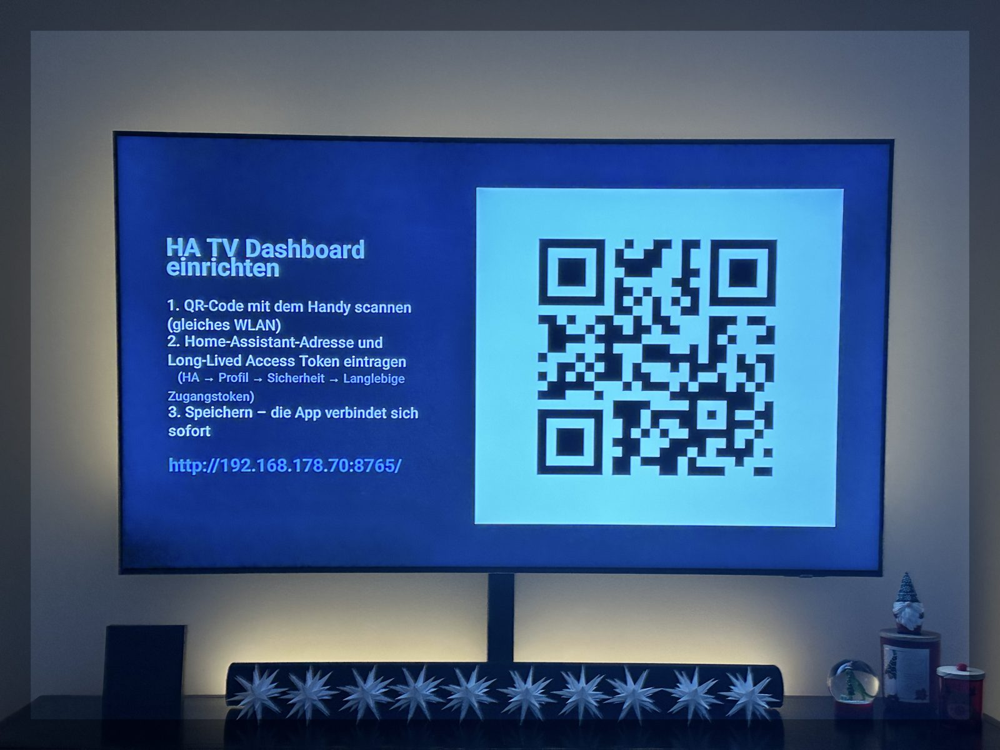
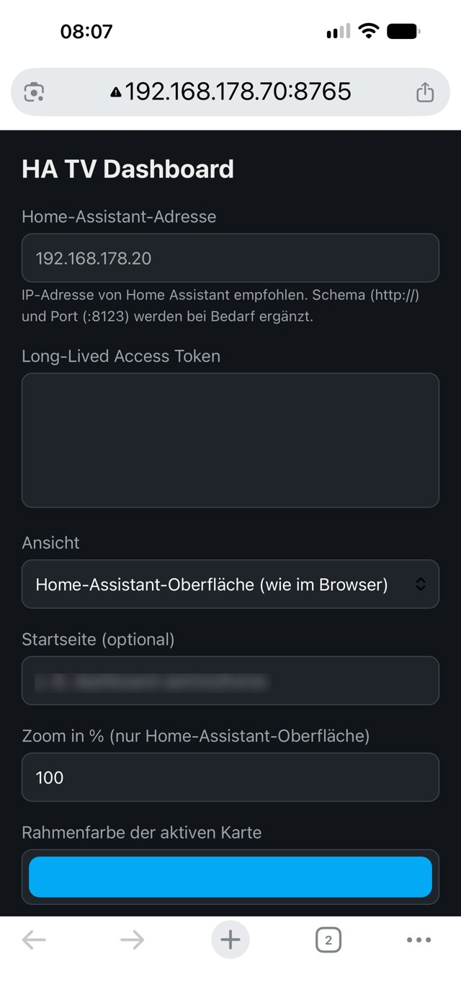
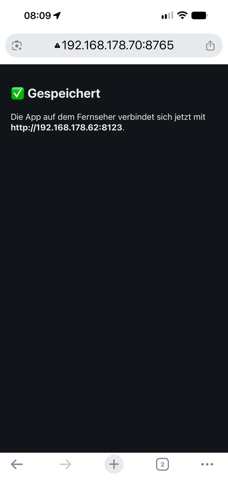

# HA TV Dashboard

[🇬🇧 English](README.md) · 🇩🇪 Deutsch

Android-TV-App, die das **Standard-Dashboard von Home Assistant** mit der Fernbedienung bedienbar macht – wie auf einer Apple-TV-Box: Eine Karte ist immer aktiv und mit einem Rahmen markiert, das Steuerkreuz wechselt zwischen den Karten.

Läuft auf der **waipu.tv Box** (Android TV 14) und dem **Fire TV Stick 4K** (Fire OS 7/8). Nicht auf Geräten mit Vega OS.

<p align="center">
  <br>
  <em>Startseite „Home“ des TV-Dashboards in der Home-Assistant-Oberfläche: eine Karte je Raum, die aktive Karte (hier das Menüsymbol) trägt den blauen Rahmen.</em>
</p>
<p align="center">
  <br>
  <em>Raumansicht „Büro“: Lichter und Schalter als Kacheln, Rollläden mit Positions- und Pfeil-Schaltflächen, oben links der Zurück-Pfeil. Die aktive Kachel (Ambientelicht mit Regler und Farbvorgaben) ist umrahmt.</em>
</p>

## Ansichten

Die App hat zwei Ansichten (Einstellung per QR-Code am Handy):

- **Home-Assistant-Oberfläche (Standard):** zeigt das echte HA-Frontend in einer WebView, also dasselbe Aussehen wie im Browser oder in der Companion-App, inklusive Theme. Ein eingeschleustes Skript (`app/src/main/assets/tv-nav.js`) übernimmt die Bedienung, siehe [Bedienung in der HA-Oberfläche](#bedienung-in-der-ha-oberfläche). Anmeldung ohne Eingabe über den Long-Lived Token.
  Einstellbar: Startseite (z. B. `dashboard-tv/home`, leer = Standard-Dashboard), Zoom und Rahmenfarbe.
- **Einfache Kacheln (nativ):** eigene, vereinfachte Darstellung (siehe unten), unabhängig vom HA-Frontend.

Die Tastenbeschreibung im Abschnitt „Bedienung“ gilt für die native Ansicht. Für die HA-Oberfläche gilt der Abschnitt davor.

## Bedienung in der HA-Oberfläche

| Taste | Funktion |
|---|---|
| Steuerkreuz | räumlich zur nächsten Karte; die aktive Karte trägt einen Rahmen (Kachel-Symbole werden übersprungen) |
| OK (kurz / lang / doppelt) | wird als Touch/Klick an die Karte gegeben; `tap_action`, `hold_action` und `double_tap_action` wertet Home Assistant selbst aus |
| OK auf Regler oder Farbwähler | schaltet einen **Bearbeiten-Modus** ein (Rahmen wird grün): Steuerkreuz ändert den Wert, erneut OK beendet den Modus |
| Zurück (kurz) | eine Seite zurück, Dialoge schließen sich; auf der obersten Ebene öffnet sich das Menü |
| Zurück (lang) | App in den Hintergrund schieben (bleibt geladen im Speicher) |
| Menü | öffnet das Menü direkt: In den Hintergrund, Weiter, Neu laden, Einstellungen, Beenden |

<p align="center">
  <br>
  <em>Langer Druck auf OK öffnet die Details einer Lampe (More-Info-Dialog). Auch hier wird per Steuerkreuz navigiert, der Rahmen liegt über dem Dialog; Regler und Farbwähler haben einen Bearbeiten-Modus.</em>
</p>
<p align="center">
  <br>
  <em>App-Menü (Menü-Taste oder Zurück auf der obersten Ebene): In den Hintergrund, Weiter, Neu laden, Einstellungen, Beenden.</em>
</p>

Details:

- **Regler** (Helligkeit, Farbtemperatur, Rollladenposition …): Nach OK bewegt rechts/oben den Regler sichtbar nach rechts/oben, links/unten entsprechend zurück, unabhängig davon, wie der Regler intern zählt (eine kurze Kalibrierung misst die Richtung). Ein Druck entspricht etwa 5 % des Wertebereichs.
- **Farbwähler:** Nach OK bewegt das Steuerkreuz den Punkt in kleinen Schritten.
- **Dialoge** (More-Info): Es wird nur im Dialog navigiert. Der Rahmen liegt dabei in der obersten Ebene des Browsers, damit er auch über Dialogen und Auswahllisten sichtbar bleibt.
- **Amazon-WebView:** Im Fire-OS-WebView werten die Einheiten `vh`/`dvh` zu 0 aus; dadurch bekam der Detail-Dialog (Bottom-Sheet) die Höhe 0. `tv-nav.js` setzt dafür beim Öffnen eine Pixelhöhe und verkleinert den Dialog auf 70 %.
- **Ladezeit:** Das HA-Frontend lädt global alle Custom-Karten und Erweiterungen (HACS, UIX, browser_mod …). Für das TV-Dashboard werden diese Skripte im WebView leer beantwortet (`BLOCK_CUSTOM_JS` in `WebDashboardScreen.kt`; ausgenommen `hass-hue-icons`). Das TV-Dashboard muss dafür mit Standardkarten (Kachel, Bereich, Überschrift, Uhr, Kurzbefehl) auskommen.

### Das „TV Dashboard“ in Home Assistant

Das mitgelieferte Bedienkonzept ist auf ein eigenes, schlankes Dashboard (`dashboard-tv`) ausgelegt: Sections-Ansicht, Übersicht, Räume, Beleuchtung und Beschattung, keine Navigationsleiste (der Zurück-Weg läuft über die Fernbedienung). Es gibt nur Standardkarten und eine Aktion je Kachel:

- Licht-/Schalterkachel: Tippen schaltet um, Halten öffnet die Details.
- Rollladenkachel: Tippen schließt, Halten öffnet, Doppeltippen stoppt.

> **Nicht im Repo enthalten:** Die Dashboard-Views (Home, Räume, Beleuchtung, Beschattung usw.) und das Hintergrundbild aus den Screenshots sind **nicht Teil dieses Repositories**. Sie liegen in Home Assistant (Einstellungen → Dashboards) und sind auf die eigene Installation, Räume und Entitäten zugeschnitten. Die App zeigt jedes beliebige Dashboard an; das TV-Dashboard in den Screenshots ist nur ein Beispiel. Die Startseite wird in der Einrichtung eingetragen (z. B. `dashboard-tv/home`).

### Unterstützte Karten

**Home-Assistant-Oberfläche:** Die App kennt keine Kartenliste. `tv-nav.js` sucht in der Seite alle bedienbaren Elemente (Schaltflächen, Links, Regler, Schalter, Elemente mit Tipp-, Halte- oder Doppeltipp-Aktion) und macht sie per Steuerkreuz erreichbar. Entscheidend ist daher, ob eine Karte so ein Element enthält und ob sie ohne Custom-Skript auskommt.

| Karte | Stand |
|---|---|
| Kachel (`tile`) mit Tipp-/Halte-/Doppeltipp-Aktion | ✅ getestet |
| Kachel-Funktionen (Helligkeitsregler, Farbvorgaben, Rollladen-Schaltflächen, Positionsvorgaben) | ✅ getestet |
| Bereichs-Kachel (Navigation in Räume) | ✅ getestet |
| Details-Dialog (More-Info) von Lichtern, Rollläden usw. | ✅ getestet |
| Schaltfläche (`button`), Entitäten (`entities`), Glance, Entität (`entity`), Überschrift (`heading`) mit Aktion | ⚪ sollte funktionieren, nicht ausführlich getestet |
| Karten ohne Bedienung (Markdown, Verlauf, Statistik, Wetter, Uhr) | 👁 werden angezeigt, aber nicht angesteuert |
| Custom-Karten (HACS, z. B. Mushroom, Bubble Card, card-mod) | ❌ nicht unterstützt: das App-Skript lässt Custom-Skripte im WebView absichtlich leer laufen (`BLOCK_CUSTOM_JS`), damit das Dashboard schnell lädt |
| Karten mit Texteingabe oder Ziehgesten (Karte/Map, Kamera-Stream, Zeichnen, Schieberegler per Wischen) | ❌ nicht bedienbar mit der Fernbedienung (Regler gehen über den Bearbeiten-Modus) |

**Native Ansicht:** liest Standard-Dashboards (oder eine gespeicherte Konfiguration) und baut daraus eigene Kacheln. Unterstützt werden `tile`, `button`, `entities`, `glance`, `vertical-stack`, `horizontal-stack`, `grid`, Sections-Ansichten, `heading` und `area` mit ihren Aktionen. Alle anderen Kartentypen werden übersprungen.

### Im Hintergrund bereithalten

- Die App startet beim Öffnen einen Dienst im Vordergrund (`KeepAliveService`, Dauerbenachrichtigung mit niedrigster Wichtigkeit). Dadurch bleibt der Prozess samt geladenem Dashboard im Speicher, und die App steht nach „In den Hintergrund“ sofort bereit.
- Beim Zurückkehren lädt die Seite nach mehr als 30 Minuten Pause neu; bei kürzerer Pause nur, wenn die Verbindung zu Home Assistant abgerissen ist.
- *Beenden* im Menü stoppt den Dienst und schließt die App ganz.
- Optional: `adb shell dumpsys deviceidle whitelist +io.nachklang.hatv` nimmt die App von der Energiesparfunktion aus.

### Zurück lang aus einer anderen App (optional)

`BackKeyService` ist ein Bedienungshilfendienst, der nur die Zurück-Taste auswertet, wenn die App nicht im Vordergrund ist. Ein langer Druck holt die App dann nach vorn.

```bash
adb shell settings put secure enabled_accessibility_services io.nachklang.hatv/io.nachklang.hatv.BackKeyService
adb shell settings put secure accessibility_enabled 1
adb shell appops set io.nachklang.hatv SYSTEM_ALERT_WINDOW allow   # Erlaubnis, aus dem Hintergrund nach vorn zu holen
```

Einschränkung: Tasten, die per **HDMI-CEC** (zum Beispiel Fernbedienung eines Projektors oder Fernsehers) ankommen, schickt Android als eingespielte Ereignisse ein, und die sehen Bedienungshilfen nicht. Mit der Original-Fernbedienung der Box funktioniert es. Mit CEC-Fernbedienung bleibt das Menü (*In den Hintergrund*) oder das Starten der App über Home Assistant.

### Fehlersuche

Die Skript- und Konsolenausgaben des WebViews landen mit dem Tag `TVDBG` im Logcat:

```bash
adb -s <IP>:5555 logcat -s TVDBG | grep -E "TVDBG (tv-nav|event|dialogs|fix|cal|slider|error)"
```

`tv-nav v… geladen` verrät, welche Skriptversion läuft (zum Prüfen, ob die neue APK installiert ist).

## Bedienung (native Ansicht)

| Taste | Funktion |
|---|---|
| Steuerkreuz | zwischen den Karten wechseln, die aktive Karte trägt einen Rahmen |
| OK (kurz) | Standardfunktion: Licht/Schalter umschalten, Rollladen auf/zu, Szene/Skript ausführen, Bereich öffnen |
| OK (lang, ≥ 500 ms) | Detailansicht mit Reglern und Schaltflächen |
| OK (doppelt, < 300 ms) | zweite Funktion (siehe unten) |
| Zurück | eine Ebene zurück; auf der Startseite zweimal zum Beenden |

**Doppelklick je Domain:** Licht → 100 %, Rollladen → Stopp, Medien → Play/Pause, Klima → ein/aus, Saugroboter → zur Basis, sonst → alle Entitäten des Geräts.
Auf Karten mit Doppelklick-Funktion wartet ein einfacher Druck 300 ms auf einen möglichen zweiten Druck. Karten ohne Doppelklick reagieren sofort.

**Detailansicht:** links/rechts stellen Helligkeit, Position, Solltemperatur, Lautstärke oder Lüfterstufe ein (gesendet wird, sobald die Taste kurz ruht), OK schaltet.

## Ebenen

Das Standard-Dashboard hat in HA keine gespeicherte Konfiguration, HA erzeugt es automatisch. Die App baut es genauso aus Bereichen, Geräten und Entitäten nach:

1. **Home**: eine Kachel je Bereich (mit „x an“ und Temperatur), Entitäten ohne Bereich nach Domain, Einstellungen
2. **Bereich**: Entitäten nach Domain gruppiert (Licht, Rollläden, Klima …)
3. **Details**: Regler, Schaltflächen und Attribute

Ausgeblendet werden versteckte Entitäten sowie Konfigurations- und Diagnose-Entitäten, wie in HA.

Wenn du das Dashboard in HA später „übernimmst“ und bearbeitest, liest die App stattdessen die gespeicherten Views und Karten (`tile`, `button`, `entities`, `glance`, Stacks, Grids, Sections, `heading`, `area` …) inklusive `tap_action`, `hold_action` und `double_tap_action`.

## Einrichtung

1. App starten. Sie zeigt einen QR-Code.
2. Mit dem Handy scannen (gleiches WLAN) und eintragen:
   - Home-Assistant-Adresse, z. B. `http://homeassistant.local:8123` oder `http://192.168.x.y:8123`
   - Long-Lived Access Token (HA → Profil → Sicherheit → Langlebige Zugangstoken)
   - Rahmenfarbe der aktiven Karte (Standard: HA-Blau)
3. Speichern. Die App verbindet sich sofort.

<p align="center">
  <br>
  <em>Erster Start: Die App zeigt einen QR-Code und die Adresse der Einrichtungsseite im Heimnetz.</em>
</p>
<p align="center">
  
  &nbsp;&nbsp;
  <br>
  <em>Einrichtungsseite am Handy (Adresse, Token, Ansicht, Startseite, Zoom, Rahmenfarbe) und die Bestätigung nach dem Speichern. Die Screenshots zeigen die deutsche Oberfläche; die App richtet sich nach der Systemsprache.</em>
</p>

Tipp: Für den Fernseher einen eigenen HA-Benutzer ohne Admin-Rechte anlegen und dessen Token verwenden.
Die Einstellungen sind später über die Kachel **Einstellungen** auf der Startseite erreichbar.

## Bauen

Voraussetzungen: Android Studio (aktuelle Version) mit Android SDK 35.

```bash
./gradlew assembleDebug
# APK: app/build/outputs/apk/debug/app-debug.apk
```

Oder in Android Studio öffnen und *Build → Build APK(s)*.

## Installieren

Auf beiden Geräten zuerst die Entwickleroptionen aktivieren (Einstellungen → Geräteinfo → 7× auf „Build“ bzw. „Fire TV Stick“ klicken) und **ADB-Debugging** bzw. **Netzwerk-Debugging** einschalten.

1. **APK besorgen:** aus den [Releases](../../releases) (`ha-tv-dashboard-<Version>.apk`) laden oder selbst bauen (siehe oben, `app-debug.apk`).
2. **Verbinden und installieren:**

   ```bash
   adb connect <IP-der-Box>:5555
   adb install -r ha-tv-dashboard-1.1.1.apk
   adb shell pm list packages | grep hatv     # erwartet: package:io.nachklang.hatv
   ```

3. **Optional, aber empfohlen** (einmalig pro Gerät, siehe [Hintergrund](#im-hintergrund-bereithalten) und [Zurück lang](#zurück-lang-aus-einer-anderen-app-optional)):

   ```bash
   adb shell dumpsys deviceidle whitelist +io.nachklang.hatv
   adb shell appops set io.nachklang.hatv SYSTEM_ALERT_WINDOW allow
   adb shell settings put secure enabled_accessibility_services io.nachklang.hatv/io.nachklang.hatv.BackKeyService
   adb shell settings put secure accessibility_enabled 1
   ```

   Die letzten beiden Zeilen sind nur nötig, wenn ein langer Druck auf Zurück die App aus einer anderen App nach vorn holen soll (geht nicht mit CEC-Fernbedienungen).
4. **App starten** und wie unter [Einrichtung](#einrichtung) beschrieben die Zugangsdaten eintragen. Danach zeigt die Benachrichtigungsleiste die Dauerbenachrichtigung der App, und *In den Hintergrund* im Menü schiebt sie weg und zurück.

**Update:** `adb install -r` mit derselben Signatur behält die Einstellungen. Eine mit einem anderen Schlüssel signierte APK (zum Beispiel Debug-Schlüssel eines anderen Rechners) lässt sich nur nach `adb uninstall io.nachklang.hatv` installieren, dabei gehen die Einstellungen verloren.

## Sprachen

Die App ist zweisprachig: **Englisch** (Standard) und **Deutsch**. Sie folgt der Systemsprache des Geräts; ist diese weder Deutsch noch Englisch, erscheint Englisch. Das gilt für die App (Menü, Meldungen, native Ansicht), die Benachrichtigung und das Einrichtungsformular am Handy.

Die Texte liegen in `app/src/main/res/values/strings.xml` (Englisch) und `app/src/main/res/values-de/strings.xml` (Deutsch). Für eine weitere Sprache einen Ordner `values-<Sprachcode>` mit derselben Datei anlegen und den Code in `res/xml/locales_config.xml` eintragen. Code ohne Context lädt Texte über `Res.s(R.string.…)` (`App.kt`). Die Home-Assistant-Oberfläche selbst richtet sich nach der Sprache des HA-Benutzers.

## Lizenz

Lizenziert unter der [Apache License 2.0](LICENSE). Komponenten Dritter und ihre Lizenzen stehen in [NOTICE](NOTICE). Home Assistant ist eine Marke der Open Home Foundation; dieses Projekt steht in keiner Verbindung zu ihr.

## Technik

- Kotlin, Jetpack Compose for TV (`androidx.tv:tv-material`)
- Home-Assistant-WebSocket-API: `auth`, `subscribe_entities` (Live-Zustände), `config/area_registry/list`, `config/device_registry/list`, `config/entity_registry/list`, `lovelace/config`, `call_service`
- OkHttp WebSocket mit automatischem Reconnect
- Einrichtung über NanoHTTPD und QR-Code (ZXing)

| Datei | Inhalt |
|---|---|
| `data/HaClient.kt` | WebSocket-Client, Auth, Zustands-Diffs |
| `data/PageBuilder.kt` | Ebenen aus Registry bzw. Lovelace-Konfiguration |
| `data/Domains.kt` | Standardaktionen (kurz/lang/doppelt), Texte, Icons |
| `ui/PressHandler.kt` | Auswertung kurz/lang/doppelt der OK-Taste |
| `ui/PageScreen.kt` | Kachel-Raster mit Fokusrahmen und Fokus-Wiederherstellung |
| `ui/DetailScreen.kt` | Detailansicht mit Regler |
| `ui/SetupScreen.kt` | QR-Einrichtung |
| `ui/WebDashboardScreen.kt` | WebView-Ansicht, Menü, Hintergrund-Logik, Blockieren der Custom-Skripte |
| `assets/tv-nav.js` | Fernbedienungs-Navigation in der HA-Oberfläche |
| `KeepAliveService.kt` | Dienst im Vordergrund, hält die App im Speicher |
| `BackKeyService.kt` | Bedienungshilfendienst: langer Zurück-Druck holt die App nach vorn |
