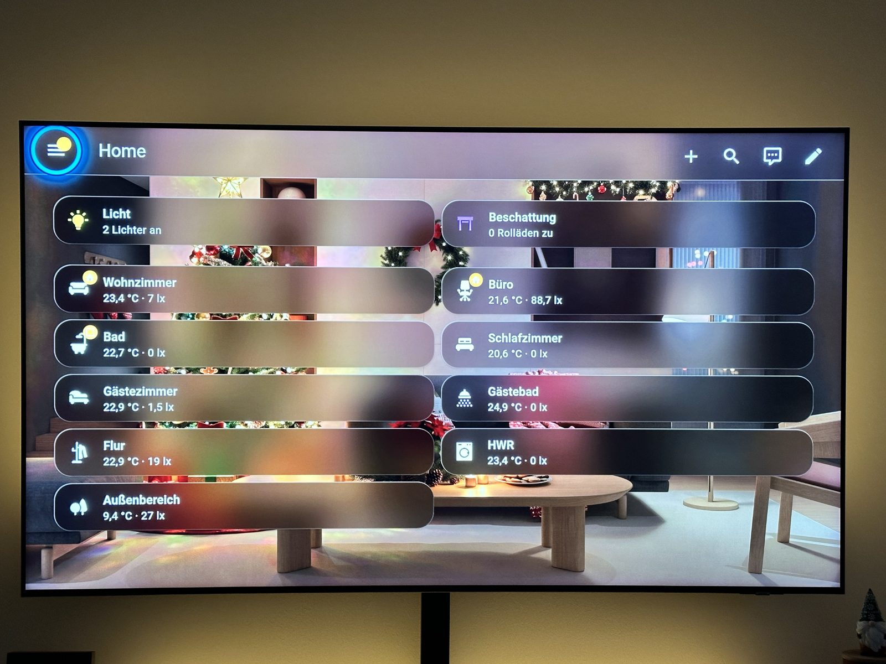
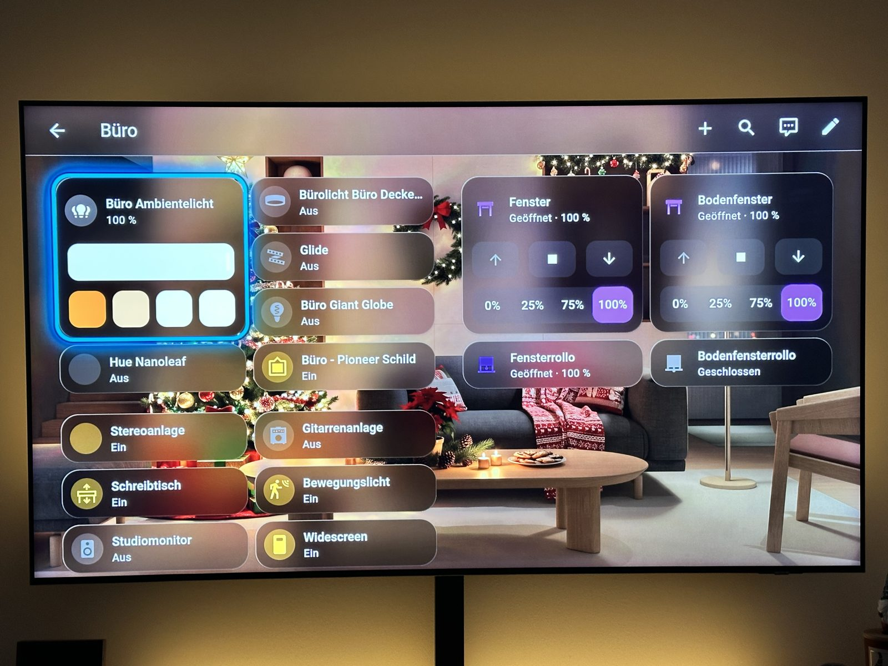
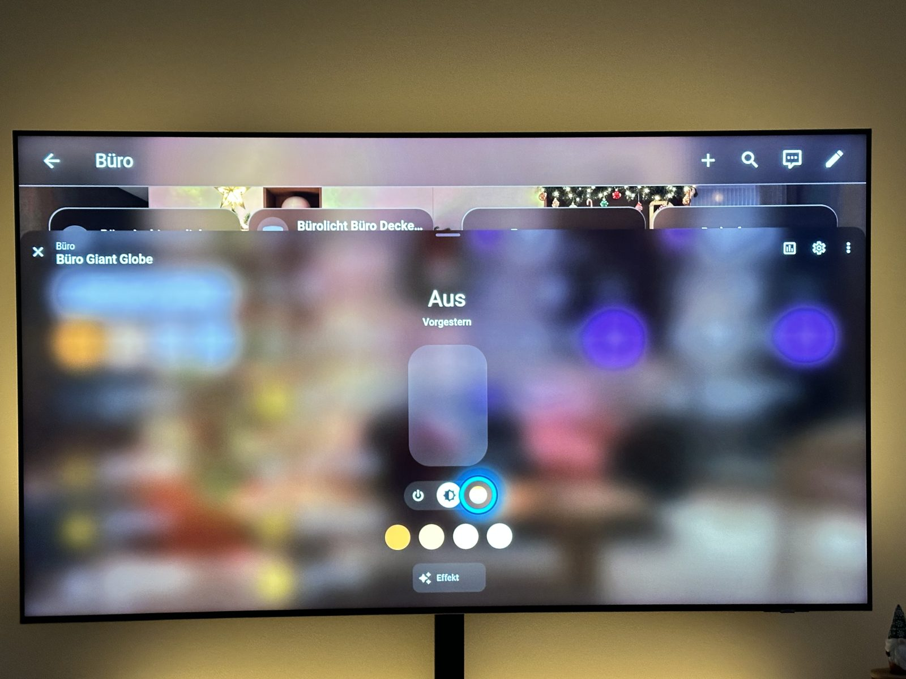
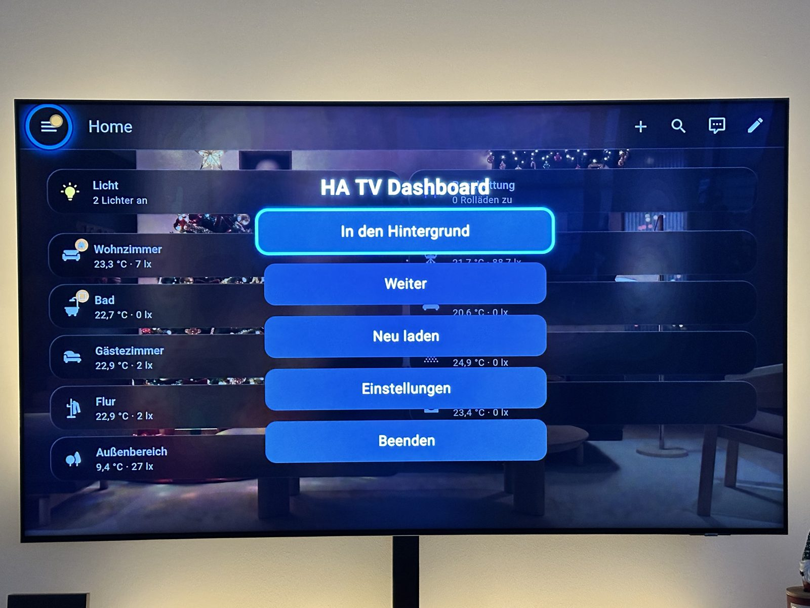
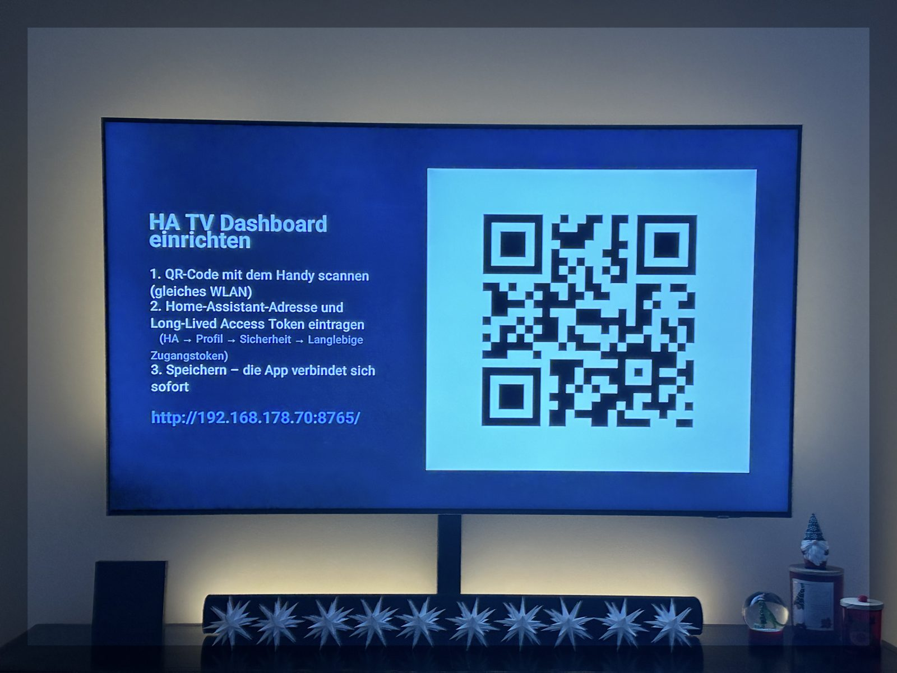
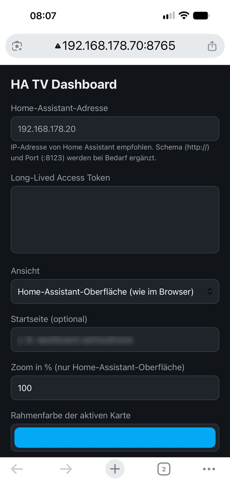
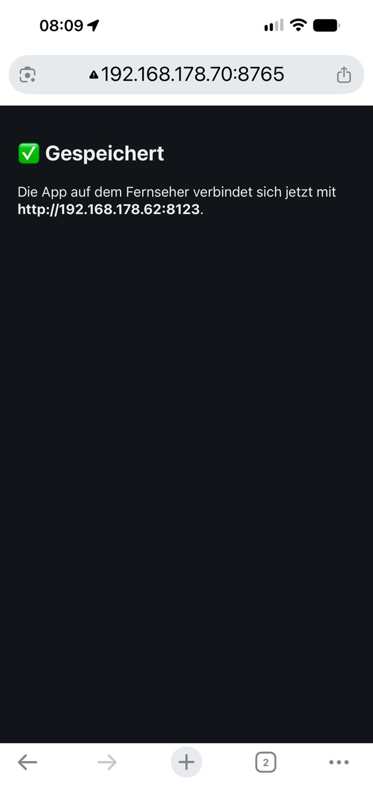

# HA TV Dashboard

🇬🇧 English · [🇩🇪 Deutsch](README.de.md)

An Android TV app that makes the **standard Home Assistant dashboard** usable with a remote control – like on an Apple TV box: one card is always active and marked with a frame, and the D-pad moves between cards.

Runs on the **waipu.tv box** (Android TV 14) and the **Fire TV Stick 4K** (Fire OS 7/8). Not on devices running Vega OS.

<p align="center">
  <br>
  <em>Home page of the TV dashboard in the Home Assistant interface: one card per room; the active card (here the menu icon) carries the blue frame. The screenshots show the German interface.</em>
</p>
<p align="center">
  <br>
  <em>Room view "Büro" (office): lights and switches as tiles, covers with position and arrow buttons, the back arrow at the top left. The active tile (ambient light with slider and color presets) is framed.</em>
</p>

## Views

The app has two views (selected via the QR code setup on your phone):

- **Home Assistant interface (default):** shows the real HA frontend in a WebView, so it looks like the browser or the companion app, including your theme. An injected script (`app/src/main/assets/tv-nav.js`) handles the remote control, see [Controls in the HA interface](#controls-in-the-ha-interface). Sign-in without typing, using a long-lived token.
  Configurable: start page (e.g. `dashboard-tv/home`, empty = default dashboard), zoom and frame color.
- **Simple tiles (native):** a simplified native rendering (see below), independent of the HA frontend.

The key table under "Controls (native view)" applies to the native view. The section before it applies to the HA interface.

## Controls in the HA interface

| Key | Function |
|---|---|
| D-pad | moves spatially to the next card; the active card carries a frame (tile icons are skipped) |
| OK (short / long / double) | sent to the card as touch/click; Home Assistant itself evaluates `tap_action`, `hold_action` and `double_tap_action` |
| OK on a slider or color picker | switches to an **edit mode** (frame turns green): the D-pad changes the value, OK again ends the mode |
| Back (short) | closes dialogs, otherwise goes back one page; on the top level it opens the menu |
| Back (long) | sends the app to the background (stays loaded in memory) |
| Menu | opens the menu directly: Send to background, Resume, Reload, Settings, Exit |

<p align="center">
  <br>
  <em>A long press on OK opens the details of a light (more-info dialog). Navigation with the D-pad works here as well, the frame is drawn above the dialog; sliders and color pickers have an edit mode.</em>
</p>
<p align="center">
  <br>
  <em>App menu (Menu key, or Back on the top level): Send to background, Resume, Reload, Settings, Exit.</em>
</p>

Details:

- **Sliders** (brightness, color temperature, cover position …): after OK, right/up moves the slider visibly to the right/up and left/down moves it back, regardless of how the slider counts internally (a short calibration measures the direction). One press is about 5 % of the value range.
- **Color picker:** after OK, the D-pad moves the dot in small steps.
- **Dialogs** (more-info): navigation stays inside the dialog. The frame is placed in the browser's top layer so it stays visible above dialogs and drop-down lists.
- **Amazon WebView:** in the Fire OS WebView the units `vh`/`dvh` evaluate to 0, which gave the details dialog (bottom sheet) a height of 0. `tv-nav.js` sets a pixel height when it opens and scales the dialog to 70 %.
- **Load time:** the HA frontend loads all custom cards and extensions globally (HACS, UIX, browser_mod …). For the TV dashboard these scripts are answered empty in the WebView (`BLOCK_CUSTOM_JS` in `WebDashboardScreen.kt`; except `hass-hue-icons`). The TV dashboard therefore has to work with standard cards (tile, area, heading, clock, shortcut).

### The "TV Dashboard" in Home Assistant

The control concept is designed for a dedicated, slim dashboard (`dashboard-tv`): sections view, overview, rooms, lighting and shading, no navigation bar (going back is done with the remote). It uses only standard cards and one action per tile:

- Light/switch tile: tap toggles, hold opens the details.
- Cover tile: tap closes, hold opens, double tap stops.

> **Not included in this repo:** the dashboard views (Home, rooms, lighting, shading etc.) and the background image from the screenshots are **not part of this repository**. They live in Home Assistant (Settings → Dashboards) and are tailored to one specific installation, rooms and entities. The app displays any dashboard; the TV dashboard in the screenshots is just an example. The start page is entered during setup (e.g. `dashboard-tv/home`).

### Supported cards

**Home Assistant interface:** the app has no list of cards. `tv-nav.js` searches the page for all operable elements (buttons, links, sliders, switches, elements with a tap, hold or double-tap action) and makes them reachable with the D-pad. What matters is whether a card contains such an element and whether it works without a custom script.

| Card | Status |
|---|---|
| Tile (`tile`) with tap / hold / double-tap action | ✅ tested |
| Tile features (brightness slider, color presets, cover buttons, position presets) | ✅ tested |
| Area tile (navigation into rooms) | ✅ tested |
| Details dialog (more-info) of lights, covers etc. | ✅ tested |
| Button (`button`), entities (`entities`), glance, entity (`entity`), heading (`heading`) with action | ⚪ should work, not tested extensively |
| Cards without interaction (markdown, history, statistics, weather, clock) | 👁 are displayed but not focusable |
| Custom cards (HACS, e.g. Mushroom, Bubble Card, card-mod) | ❌ not supported: the app deliberately answers custom scripts empty in the WebView (`BLOCK_CUSTOM_JS`) so that the dashboard loads fast |
| Cards that need text input or drag gestures (map, camera stream, drawing, swipe sliders) | ❌ not operable with a remote (sliders work via the edit mode) |

**Native view:** reads standard dashboards (or a saved configuration) and builds its own tiles. Supported are `tile`, `button`, `entities`, `glance`, `vertical-stack`, `horizontal-stack`, `grid`, sections views, `heading` and `area` with their actions. All other card types are skipped.

### Keeping the app ready in the background

- On start the app launches a foreground service (`KeepAliveService`, ongoing notification with the lowest importance). This keeps the process and the loaded dashboard in memory, so after "Send to background" the app is ready instantly.
- When you return, the page reloads after a pause of more than 30 minutes; after a shorter pause only if the connection to Home Assistant was lost.
- *Exit* in the menu stops the service and closes the app completely.
- Optional: `adb shell dumpsys deviceidle whitelist +io.nachklang.hatv` exempts the app from battery optimization.

### Long Back from another app (optional)

`BackKeyService` is an accessibility service that only evaluates the Back key while the app is not in the foreground. A long press then brings the app to the front.

```bash
adb shell settings put secure enabled_accessibility_services io.nachklang.hatv/io.nachklang.hatv.BackKeyService
adb shell settings put secure accessibility_enabled 1
adb shell appops set io.nachklang.hatv SYSTEM_ALERT_WINDOW allow   # permission to bring the app to the front from the background
```

Limitation: keys that arrive via **HDMI-CEC** (for example from a projector or TV remote) are injected by Android as synthetic events that accessibility services do not see. It works with the original remote of the box. With a CEC remote, use the menu (*Send to background*) or start the app via Home Assistant.

### Troubleshooting

The script and console output of the WebView lands in logcat with the tag `TVDBG`:

```bash
adb -s <IP>:5555 logcat -s TVDBG | grep -E "TVDBG (tv-nav|event|dialogs|fix|cal|slider|error|back)"
```

`tv-nav v… geladen` ("loaded") tells you which script version is running (useful to check that the new APK is installed).

## Controls (native view)

| Key | Function |
|---|---|
| D-pad | switch between cards, the active card carries a frame |
| OK (short) | default action: toggle light/switch, cover open/close, run scene/script, open area |
| OK (long, ≥ 500 ms) | detail view with sliders and buttons |
| OK (double, < 300 ms) | second function (see below) |
| Back | one level back; on the start page press twice to exit |

**Double click per domain:** light → 100 %, cover → stop, media → play/pause, climate → on/off, vacuum → return to dock, otherwise → all entities of the device.
On cards with a double-click function a single press waits 300 ms for a possible second press. Cards without a double click react immediately.

**Detail view:** left/right set brightness, position, target temperature, volume or fan level (sent as soon as the key rests briefly), OK toggles.

## Levels

The default dashboard has no stored configuration in HA; HA generates it automatically. The app rebuilds it the same way from areas, devices and entities:

1. **Home**: one tile per area (with "x on" and temperature), entities without an area by domain, settings
2. **Area**: entities grouped by domain (lights, covers, climate …)
3. **Details**: sliders, buttons and attributes

Hidden entities and configuration and diagnostic entities are left out, as in HA.

If you later "take control" of the dashboard in HA and edit it, the app reads the saved views and cards instead (`tile`, `button`, `entities`, `glance`, stacks, grids, sections, `heading`, `area` …) including `tap_action`, `hold_action` and `double_tap_action`.

## Setup

1. Start the app. It shows a QR code.
2. Scan it with your phone (same Wi-Fi) and enter:
   - Home Assistant address, e.g. `http://homeassistant.local:8123` or `http://192.168.x.y:8123`
   - Long-lived access token (HA → Profile → Security → Long-lived access tokens)
   - Frame color of the active card (default: HA blue)
3. Save. The app connects right away.

<p align="center">
  <br>
  <em>First start: the app shows a QR code and the address of the setup page in your home network.</em>
</p>
<p align="center">
  
  &nbsp;&nbsp;
  <br>
  <em>Setup page on the phone (address, token, view, start page, zoom, frame color) and the confirmation after saving. The screenshots show the German interface; the app follows the system language.</em>
</p>

Tip: create a separate non-admin HA user for the TV and use its token.
You can reach the settings later via the **Settings** tile on the start page or the menu.

## Build

Requirements: Android Studio (current version) with Android SDK 35.

```bash
./gradlew assembleDebug
# APK: app/build/outputs/apk/debug/app-debug.apk
```

Or open the project in Android Studio and use *Build → Build APK(s)*.

## Install

On both devices first enable the developer options (Settings → About → click "Build" / "Fire TV Stick" 7 times) and switch on **ADB debugging** or **network debugging**.

1. **Get the APK:** download it from the [Releases](../../releases) (`ha-tv-dashboard-<version>.apk`) or build it yourself (see above, `app-debug.apk`).
2. **Connect and install:**

   ```bash
   adb connect <IP-of-the-box>:5555
   adb install -r ha-tv-dashboard-1.1.0.apk
   adb shell pm list packages | grep hatv     # expected: package:io.nachklang.hatv
   ```

3. **Optional but recommended** (once per device, see [Background](#keeping-the-app-ready-in-the-background) and [Long Back](#long-back-from-another-app-optional)):

   ```bash
   adb shell dumpsys deviceidle whitelist +io.nachklang.hatv
   adb shell appops set io.nachklang.hatv SYSTEM_ALERT_WINDOW allow
   adb shell settings put secure enabled_accessibility_services io.nachklang.hatv/io.nachklang.hatv.BackKeyService
   adb shell settings put secure accessibility_enabled 1
   ```

   The last two lines are only needed if a long press on Back should bring the app to the front from another app (does not work with CEC remotes).
4. **Start the app** and enter the credentials as described under [Setup](#setup). The notification area then shows the app's ongoing notification, and *Send to background* in the menu moves it away and back.

**Update:** `adb install -r` with the same signature keeps your settings. An APK signed with a different key (for example the debug key of another computer) can only be installed after `adb uninstall io.nachklang.hatv`; the settings are lost then.

**Upgrading from before 1.0.0:** the package used to be `de.ring.hatv`. Remove the old app with `adb uninstall de.ring.hatv` and enter the credentials again.

## Languages

The app is bilingual: **English** (default) and **German**. It follows the system language of the device; if that is neither German nor English, English is shown. This applies to the app (menu, messages, native view), the notification and the setup form on the phone.

The texts live in `app/src/main/res/values/strings.xml` (English) and `app/src/main/res/values-de/strings.xml` (German). To add a language, create a folder `values-<language code>` with the same file and add the code to `res/xml/locales_config.xml`. Code without a Context loads texts via `Res.s(R.string.…)` (`App.kt`). The Home Assistant interface itself follows the language of the HA user.

## Technical notes

- Kotlin, Jetpack Compose for TV (`androidx.tv:tv-material`)
- Home Assistant WebSocket API: `auth`, `subscribe_entities` (live states), `config/area_registry/list`, `config/device_registry/list`, `config/entity_registry/list`, `lovelace/config`, `call_service`
- OkHttp WebSocket with automatic reconnect
- Setup via NanoHTTPD and QR code (ZXing)

| File | Content |
|---|---|
| `data/HaClient.kt` | WebSocket client, auth, state diffs |
| `data/PageBuilder.kt` | levels from the registry or the Lovelace configuration |
| `data/Domains.kt` | default actions (short/long/double), texts, icons |
| `ui/PressHandler.kt` | evaluation of short/long/double press of the OK key |
| `ui/PageScreen.kt` | tile grid with focus frame and focus restoration |
| `ui/DetailScreen.kt` | detail view with slider |
| `ui/SetupScreen.kt` | QR setup |
| `ui/WebDashboardScreen.kt` | WebView view, menu, background logic, blocking of custom scripts |
| `assets/tv-nav.js` | remote control navigation in the HA interface |
| `KeepAliveService.kt` | foreground service that keeps the app in memory |
| `BackKeyService.kt` | accessibility service: a long Back press brings the app to the front |
